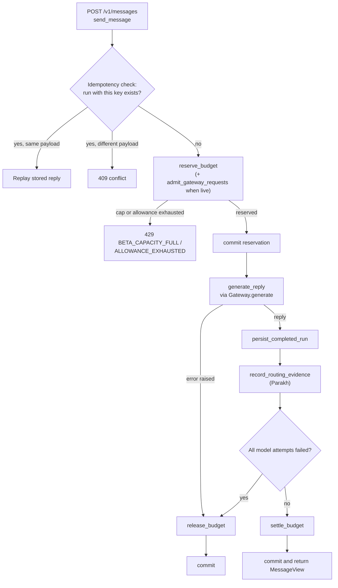

# Karmi

[](https://github.com/Ruud-en-Blauw/Karmi/actions/workflows/ci.yml)

Karmi is a study and productivity assistant for students in India. It replies in Hindi, English or a
mix, and runs as a mobile app (Flutter) on top of a bounded, privacy-scoped FastAPI backend.

## Status

Beta (app version `0.1.0+5`), India-first, invite adults only.

- **Platforms:** Android is the first channel. iOS builds exist but are experimental and untested on
  a device. See [docs/install.md](docs/install.md) for Android and iOS (experimental).
- **Models:** free models only, through the model gateway (OpenRouter and OpenCode adapters). Without
  a provider key the backend answers with deterministic demo copy.
- **No payments:** paid checkout is disabled and there is no live charge path. Plan prices are the
  owner's labels; quotas and costs are synthetic or provisional.
- **No WhatsApp:** `Settings` refuses to start with WhatsApp enabled.

Limits you will notice: all live replies share one provider key with a daily cap of 50 requests
(`DAILY_AGENT_GATEWAY_DAILY_REQUEST_LIMIT`). When it is used up the API returns
`429 BETA_CAPACITY_FULL` with the reset time.

## How a message is handled

`POST /v1/messages`: the handler is `send_message` in `src/daily_agent/api.py`. The streaming chat
route (`POST /v1/chat/stream`) follows the same reserve, generate, settle pattern; see
[docs/architecture.md](docs/architecture.md).



## Quickstart: backend

Needs Python 3.12 or newer. No provider keys are needed; replies are demo copy.

```bash
python -m venv .venv
.venv/bin/python -m pip install -c requirements.lock -e '.[dev]'
.venv/bin/python scripts/tasks.py doctor
.venv/bin/python scripts/tasks.py dev
```

On Windows PowerShell use `.\.venv\Scripts\python.exe` instead of `.venv/bin/python`.

Open <http://127.0.0.1:8000/> for the web shell and <http://127.0.0.1:8000/docs> for the API
explorer. `POST /dev/token` issues a synthetic local identity while development authentication is
enabled (the default outside production). Every `make <task>` target delegates to
`python scripts/tasks.py <task>`. Settings are listed in [docs/configuration.md](docs/configuration.md).

## Quickstart: app

See [mobile/README.md](mobile/README.md) (Flutter 3.47.5; application ID `ai.karmi.app`).

## Implemented and planned

Implemented (see [docs/release1/RELEASE_NOTES_v0.1.0.md](docs/release1/RELEASE_NOTES_v0.1.0.md)):
streaming chat with resume, stop, continue and regenerate; saved conversations with search; Google
and email-code sign-in through Clerk; four synthetic plan tiers unlocked by beta access codes;
in-app bug reports; an operator web dashboard at `/admin`; the model gateway with a shared daily
request cap; Parakh routing evidence and shadow-only policy bundles; an offline model lab.

Planned or out of scope for now ([docs/blueprint/PRD.md](docs/blueprint/PRD.md), "Current
direction"): paid checkout, WhatsApp, notes and durable memory (removed by owner decision), paid
models, and the Release 1.1 backlog ([docs/release1/R1_1_BACKLOG.md](docs/release1/R1_1_BACKLOG.md)).

## For developers

The backend Python package is `daily_agent` (distribution name `daily-agent`), under
`src/daily_agent/`. The offline benchmark tool is `src/model_lab/`; the mobile app is `mobile/`
(package `karmi_app`).

```bash
python scripts/tasks.py lint
python scripts/tasks.py typecheck
python scripts/tasks.py test-unit
python scripts/tasks.py test-e2e
python scripts/tasks.py test-integration   # needs Docker or podman
python scripts/tasks.py test-release       # doctor, lint, typecheck, unit, e2e, model lab demo, then integration
```

## More

- [docs/README.md](docs/README.md): index of the documentation folders
- [docs/configuration.md](docs/configuration.md): every `DAILY_AGENT_*` setting
- [docs/architecture.md](docs/architecture.md): components and request flow
- [CONTRIBUTING.md](CONTRIBUTING.md)
- [SECURITY.md](SECURITY.md)
- [LICENSE](LICENSE) (MIT)
