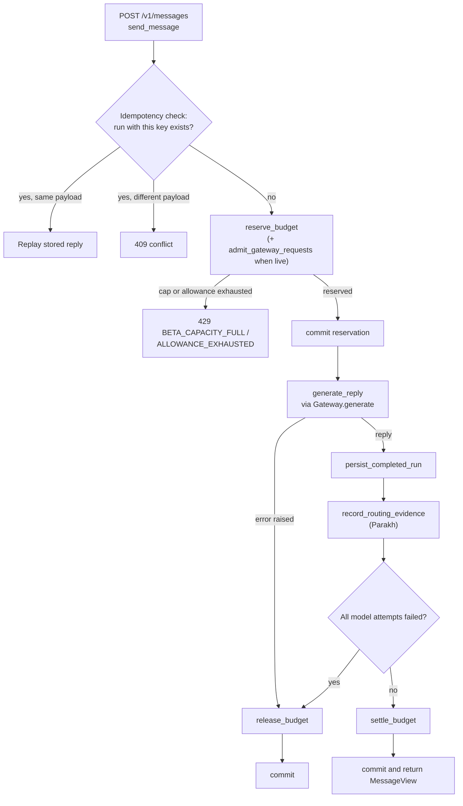

# Architecture

This is the short, code-checked view. The longer planning document is
[blueprint/Architecture.md](blueprint/Architecture.md); where the two differ, the code wins (see
[Differences from the blueprint](#differences-from-the-blueprint)).

## Components

| Component | Where | What it does |
|---|---|---|
| Backend API | `src/daily_agent/` (`api.py` builds the FastAPI app; `routes/` holds the admin, conversations and streaming routers) | Authentication, plan and budget accounting, chat, conversations, usage, bug reports, admin API. |
| Model gateway | `src/daily_agent/gateway/` | Reviewed zero-price model registry, rules router, OpenRouter and OpenCode adapters, circuit breaker and cooldowns. At most two provider attempts per request. |
| Web pages | `src/daily_agent/web/` | A dependency-free web shell served at `/`, and the operator dashboard served at `/admin` (can be turned off with `DAILY_AGENT_ADMIN_UI_ENABLED`). |
| Mobile app | `mobile/` (Flutter, package `karmi_app`) | The Karmi client for Android; iOS is experimental. See [mobile/README.md](../mobile/README.md). |
| Model lab | `src/model_lab/`, `benchmarks/` | An offline benchmark and evaluation CLI (`model-lab`), independent of the API. |
| Parakh | `src/daily_agent/parakh/`, [contracts/parakh/](contracts/parakh/) | Karmi's side of the Parakh exchange: records routing evidence, exports sanitized telemetry batches, verifies signed policy bundles. Bundles are shadow-only: they record what they would have chosen and never change the executed route. |
| Database | `src/daily_agent/models.py`, `migrations/` (Alembic) | SQLAlchemy models. PostgreSQL in production; SQLite for local development. |
| Optional Redis | `src/daily_agent/redis_client.py` | Shared rate limits, maintenance locks and stream state. Everything falls back to in-process state without it. |

## Request flow: `POST /v1/messages`

Code map (all paths under `src/daily_agent/`):

| Step | Code |
|---|---|
| Route handler, then `execute_message` | `api.py:706`, `api.py:503` |
| Idempotency check (request hash plus lookup by logical request id; mismatch is a conflict) | `api.py:514-533` |
| Reserve budget | `api.py:548`, `services.py:330` |
| Gateway capacity admission (live gateway only) | `api.py:559` |
| Commit reservation | `api.py:594` |
| Generate | `api.py:598`, `services.py:916`, `gateway/service.py:149` |
| Persist | `api.py:618`, `services.py:1078` |
| Routing evidence | `api.py:632`, `parakh/routing.py:195` |
| Settle or release | `api.py:645-649`, `services.py:531`, `services.py:623` |
| Final commit | `api.py:657` |

With no live provider the gateway is not used and `generate_reply` returns deterministic demo copy
(`services.py:957-964`).

### Streaming

`POST /v1/chat/stream` (`routes/stream.py:427`) handles chat in the app. It follows the same
reserve, generate, settle pattern with a different idempotency key (conversation id plus client
message id), runs generation in the background (`routes/stream.py:385`, `streaming/runner.py`), and
delivers tokens as Server-Sent Events. The same router offers resume, stop, continue and regenerate.
Settlement lives in `streaming/runner.py:244`.

## Differences from the blueprint

[blueprint/Architecture.md](blueprint/Architecture.md) is marked as a proposed design. Checked
against the code:

- **Layout.** The blueprint proposes `apps/api/app/...` modules; the code is `src/daily_agent/`.
- **Object storage.** The blueprint proposes an S3-compatible store (MinIO); no object storage code
  exists in `src/`.
- **Redis.** The blueprint uses Redis for queues and cache; the code runs without Redis and uses a
  SQL outbox, with Redis as an optional accelerator.
- **Admin.** The blueprint proposes a TypeScript admin application; the code serves a server-rendered
  page at `/admin` over the `/v1/admin/*` API (`web/admin_page.py`, `routes/admin.py`).
- **API table.** The blueprint lists `/webhooks/whatsapp`, `GET/DELETE /v1/memory/{id}`, CRUD
  `/v1/notes`, `GET /v1/runs/{id}` and `/admin/*` as the admin API. In the code WhatsApp is disabled,
  notes and memory have been removed, there is no `GET /v1/runs/{id}` (only run feedback,
  regenerate and event routes), admin routes live under `/v1/admin/`, and the billing webhook is a
  development-only sandbox that returns 404 outside development.
- **Task API.** The blueprint says CRUD for tasks and reminders; the code has `GET`/`POST
  /v1/tasks`, `PATCH /v1/tasks/{id}/complete` and `POST /v1/reminders`.
- **Run lifecycle.** The blueprint describes a classifier, context build and an
  evaluate, repair and escalate loop. The code uses a rules router and the gateway: at most two
  provider attempts, a failed validation escalates one class, and a final failure releases the
  reservation (`gateway/service.py:1-9`).
- **Deployment note.** The blueprint's own banner already says notes and memory are removed and
  that model calls go through `src/daily_agent/gateway/`.
